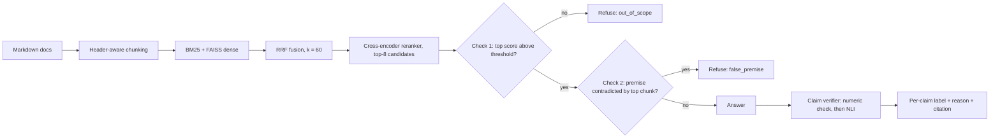

# rag-claim-audit


I built this after working through LangChain, PyTorch and the usual RAG tutorials and noticing that most of my projects stopped at "it returned something plausible". I wanted numbers instead: where does dense retrieval actually beat BM25 on my own notes, does a small cross-encoder reranker earn its CPU latency, and can I catch the specific sentences in an answer that the retrieved text does not support. It is a small diagnostic pipeline over markdown notes I wrote on transformers, fine-tuning, quantization, distributed training, serving, retrieval and evaluation. It is a measurement tool first and a QA system second.

Version 2 changes, each driven by a v1 limitation written down in the v0.1.0 release: the corpus grew from 6 notes to 32 (303 header-aware chunks) and the eval set from 20 queries to 60, so Hit@3 no longer saturates; the reranker candidate pool is capped at 8 instead of 20; the claim verifier now runs a real NLI model (DeBERTa-v3) behind the numeric check instead of relevance alone; and the abstention gate gained a second check aimed at false-premise questions, which v1 failed on completely.

## Pipeline



Components, in `src/`:

- `chunking.py` - header-aware splitting with LangChain (`MarkdownHeaderTextSplitter`, then `RecursiveCharacterTextSplitter` at 800/100), plus a fixed-size variant for comparison. Every chunk keeps `source_file` and `section`.
- `retrievers.py` - `BM25Okapi`, FAISS `IndexFlatIP` over `all-MiniLM-L6-v2` embeddings, reciprocal rank fusion, and a `ms-marco-MiniLM-L-6-v2` cross-encoder reranker. Only the top 8 fused candidates reach the reranker (configurable via `top_k_candidates`); v1 reranked all 20.
- `grounding.py` - the claim verifier. Per claim, against its best-matching chunk, in this order: (A) any number in the claim that the chunk does not contain makes it `unsupported` with reason `numeric_mismatch`; (B) NLI contradiction probability >= 0.50 makes it `unsupported` with reason `contradiction`; (C) NLI entailment >= 0.60 makes it `supported`; (D) anything else is `weakly_supported`. The NLI model is `cross-encoder/nli-deberta-v3-small`, always fed `(premise, hypothesis) = (chunk_text, claim)`. Raw logits go through an explicit stable softmax in this module, and the label order is read from the model config's `id2label` instead of being assumed, because both have differed across sentence-transformers versions.
- `pipeline.py` - ties it together, with a three-check abstention gate: check 1 refuses `out_of_scope` when the reranked top score (a sigmoid-squashed logit) is under the threshold; check 2 refuses `false_premise` when the NLI contradiction probability of the question against the top chunk is >= 0.55; check 3, in audit mode, flags a draft answer `ungrounded` when its grounding ratio is under 0.50 or any claim contradicts its source.
- `api.py` - FastAPI wrapper: `GET /health`, `POST /retrieve`, `POST /audit`. Responses gained `refusal_reason` and, for audits, per-claim `reason` / `contradiction` fields and an overall `ungrounded` flag; all v1 fields are unchanged.

There is also a lightweight mode (`RAG_LIGHTWEIGHT=1`, TF-IDF vectors and term-coverage scoring behind the same interfaces, deterministic heuristics standing in for the NLI model) so the test suite and CI run in seconds without downloading models. Numbers from lightweight mode are not reported anywhere in this README; the ablation below used the real models on CPU.

A standalone Gradio demo lives in `demo/` (`pip install -r demo/requirements.txt`, then `python demo/app.py`). Gradio is deliberately not in the root requirements, the Dockerfile, or CI.

## Ablation results

Measured with `python scripts/run_ablation.py` on the 60 queries in `eval/queries.jsonl` (36 answerable, 14 out of scope, 10 false premise) over the 32-note corpus (303 header-aware chunks). Full per-query output is in `eval/ablation_results.md`. Refusal in this table is check 1 (the score gate) alone; the full gate is calibrated separately below.

| method | Hit@3 | MRR@5 | refusal accuracy | out-of-scope refusal | false-premise refusal | answerable false-refusal | median latency |
|---|---|---|---|---|---|---|---|
| bm25 | 0.944 | 0.931 | 0.600 | 0.000 | 0.000 | 0.000 | 2.6 ms |
| dense_faiss | 0.917 | 0.881 | 0.700 | 0.429 | 0.000 | 0.000 | 102.4 ms |
| hybrid_rrf | 0.917 | 0.914 | 0.617 | 0.071 | 0.000 | 0.000 | 110.3 ms |
| hybrid_rrf_rerank (top-20 candidates) | 0.944 | 0.881 | 0.800 | 1.000 | 0.000 | 0.056 | 4310.5 ms |
| hybrid_rrf_rerank (top-8 candidates) | 0.944 | 0.885 | 0.800 | 1.000 | 0.000 | 0.056 | 1892.0 ms |

What moved compared to v1:

- Capping the reranker pool at 8 candidates cut median latency from 4310.5 ms to 1892.0 ms (about 2.3x faster) with no ranking cost on this set: Hit@3 identical at 0.944, MRR@5 0.885 vs 0.881. The cap is the single clearest win in v2.
- Hit@3 no longer saturates. With 32 notes on related topics, the right file is not automatic: Q03 (a paraphrase about serving memory) misses the top 3 entirely for the reranked pipeline, and Q11 lands the right file only at rank 5. BM25 now ties the reranked pipeline on Hit@3 and beats it on MRR (0.931 vs 0.885); plain hybrid RRF has the best MRR of the neural-free methods at 0.914. The reranker still does not earn its latency on ranking quality. What it earns it on is refusal: its roughly calibrated scores are the only ones where a threshold separates out-of-scope queries (1.000) from answerable ones, while BM25 and RRF scores refuse none of the out-of-scope set at thresholds that keep answerable queries alive.
- Chunking, with `hybrid_rrf` held fixed: fixed-size splitting (294 chunks) scored Hit@3 0.972 / MRR@5 0.907 against header-aware (303 chunks) at 0.917 / 0.914. In v1 they tied. Header-aware stays the default because its citations name a real section, but on this corpus it is no longer even arguably the better retriever, and the README is not going to pretend otherwise.

## Gate calibration

The full pipeline gate (rerank top-8, check 1 at 0.35, premise check at contradiction >= 0.55), measured on the same 60 queries:

| metric | value |
|---|---|
| refusal accuracy (all 60 queries) | 0.833 |
| out-of-scope refusal accuracy (14 queries) | 1.000 |
| false-premise refusal accuracy (10 queries) | 0.300 |
| answerable false-refusal rate (36 queries) | 0.083 |
| NLI premise check latency (median, per query) | 1445.2 ms |
| NLI claim check latency (median, per claim-chunk pair) | 813.5 ms |

The premise check catches false premises stated as assertions (direct claims about GRPO critics, BM25 b, and activation checkpointing cost: Q54, Q56, Q60). It misses most premises phrased as questions, including both v1 failures Q17 and Q20: DeBERTa scores the interrogative form as neutral against the chunk (contradiction probability 0.02 for Q17), because a question does not assert anything. It also misses a numeric premise (Q57, "adds about 2 extra bits") because NLI does not compare numbers, and it produced one false refusal on an answerable query (Q07, contradiction 0.79 against a QLoRA memory chunk). Net effect versus the score gate alone: refusal accuracy 0.800 -> 0.833, false-premise refusal 0.000 -> 0.300, at the cost of one extra false refusal and about 1.4 s of CPU per query. That is progress, documented as partial, not a solved problem. Details and per-query outcomes are in `eval/ablation_results.md`.

## Claim audit example

Real output from the v2 pipeline (`eval/sample_audit.json`), auditing a draft answer where I changed one number on purpose (0.5 MB -> 5 MB):

```json
{
  "question": "How much memory does the KV cache use per token for a 32-layer model with d_model 4096 in fp16?",
  "claims": [
    {
      "claim": "The KV cache holds 0.5 MB per token for a 32-layer model with d_model 4096 in fp16.",
      "label": "weakly_supported",
      "score": 1.0,
      "numeric_mismatch": false,
      "contradiction": false,
      "reason": "insufficient_entailment",
      "citation": {"source_file": "transformers_attention.md", "section": "KV cache"}
    },
    {
      "claim": "Batch size in production serving is usually limited by KV cache memory, not weights.",
      "label": "supported",
      "score": 0.999,
      "numeric_mismatch": false,
      "contradiction": false,
      "reason": "entailed",
      "citation": {"source_file": "transformers_attention.md", "section": "KV cache"}
    },
    {
      "claim": "The KV cache holds 5 MB per token for a 32-layer model with d_model 4096 in fp16.",
      "label": "unsupported",
      "score": 1.0,
      "numeric_mismatch": true,
      "contradiction": false,
      "reason": "numeric_mismatch",
      "citation": {"source_file": "transformers_attention.md", "section": "KV cache"}
    }
  ],
  "grounding_ratio": 0.333,
  "ungrounded": true
}
```

Two honest observations. The drifted claim is still caught by the numeric check, not by NLI: the cross-encoder relevance score is 1.0 and the NLI model also treats the sentence as a normal claim about the chunk; only the exact number comparison flags it. And the correct first claim is demoted to `weakly_supported` because DeBERTa's entailment probability for a number-dense sentence against its source chunk did not reach 0.60, which drags the grounding ratio to 0.333 and trips the `ungrounded` flag on a draft that is two-thirds correct. The verifier is conservative in a specific, measurable way: it under-trusts numeric claims. That trade is preferable to the v1 failure mode (trusting relevance), but it is a trade, and it is recorded here rather than tuned away quietly.

## What broke / known limitations

- The premise check only works on assertion-style questions. 7 of the 10 false-premise queries were not refused, including the two carried over from v1 (Q17, Q20). The measured reason is phrasing: DeBERTa-v3-small returns neutral for interrogative hypotheses. Fixing this properly means restating the question's premise as a declarative claim before the NLI call, which is a design change, not a threshold change; it is not in v2.
- The NLI model is slow on CPU. A premise check costs a median of 1445.2 ms and a single claim check 813.5 ms on the machine that ran the ablation, so a full audit of a 5-claim draft adds roughly 4 s of NLI time on top of retrieval. The end-to-end audit of the sample above took 12.4 s. On GPU this is a non-issue; on CPU it makes the verifier a batch tool, not an interactive one.
- DeBERTa-v3-small is weak on numeric entailment, as the audit example shows: correct numeric claims get `weakly_supported` when the model cannot verify the arithmetic relationship. The deterministic numeric check compensates for wrong numbers but cannot promote a correct number to `supported` on its own.
- The reranker still does not improve ranking on this corpus (MRR 0.885 reranked vs 0.914 for plain hybrid RRF) and still falsely refuses Q03 and Q09 at the 0.35 threshold even though Q09's correct chunk is in the top 3. Its value is confined to refusal calibration.
- Claims whose evidence spans two chunks are checked against one best chunk only, so multi-chunk synthesis claims can be marked `weakly_supported` or `unsupported` even when the retrieved set jointly supports them. The verifier has no notion of combining evidence.
- The corpus is still self-written and the queries are still mine, so every number here describes this pipeline on this data. 60 queries is better than 20 and still small: one query is worth about 1.7 points of refusal accuracy.

## Run it locally

```bash
pip install -r requirements.txt
python scripts/run_ablation.py        # downloads the three models on first run, writes eval/ablation_results.md
uvicorn src.api:app --reload          # http://localhost:8000/docs
pytest                                # lightweight mode, no model downloads
python demo/app.py                    # optional Gradio demo, needs demo/requirements.txt
```

```bash
curl -X POST localhost:8000/audit -H "Content-Type: application/json" \
  -d '{"question": "How much memory does the KV cache use per token?", "draft_answer": "The KV cache holds 5 MB per token."}'
```

Optional live generation (`--live` in `src/pipeline.py`) uses any OpenAI-compatible endpoint. Copy `.env.example` to `.env` and set `LLM_API_KEY`, `LLM_BASE_URL` and `GEN_MODEL` there. Nothing in the code reads a hardcoded key, and the default path is extractive, so the repo runs end to end with no API key at all.

## Layout

```
corpus/    32 markdown notes
eval/      queries.jsonl (60), ablation_results.md/.json, sample_audit.json
src/       chunking, retrievers, grounding, pipeline, api
scripts/   run_ablation.py
demo/      standalone Gradio demo (own requirements.txt)
tests/     test_core.py (chunking, RRF, grounding, NLI, refusal gate, API)
```
