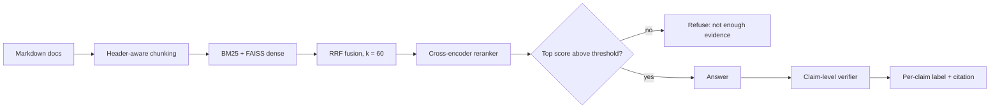

# rag-claim-audit


I built this after working through LangChain, PyTorch and the usual RAG tutorials and noticing that most of my projects stopped at "it returned something plausible". I wanted numbers instead: where does dense retrieval actually beat BM25 on my own notes, does a small cross-encoder reranker earn its CPU latency, and can I catch the specific sentences in an answer that the retrieved text does not support. So this is a small diagnostic pipeline over six markdown notes I wrote on transformers, LoRA, retrieval, RLHF/DPO, evaluation metrics and inference optimization. It is a measurement tool first and a QA system second.

## Pipeline



Components, in `src/`:

- `chunking.py` - header-aware splitting with LangChain (`MarkdownHeaderTextSplitter`, then `RecursiveCharacterTextSplitter` at 800/100), plus a fixed-size variant for comparison. Every chunk keeps `source_file` and `section`.
- `retrievers.py` - `BM25Okapi`, FAISS `IndexFlatIP` over `all-MiniLM-L6-v2` embeddings, reciprocal rank fusion, and a `ms-marco-MiniLM-L-6-v2` cross-encoder reranker.
- `grounding.py` - splits an answer into sentences, scores each claim against the retrieved chunks, and labels it `supported` / `weakly_supported` / `unsupported`. A claim whose numbers do not appear in its best-matching chunk is flagged `unsupported` with `numeric_mismatch: true`, regardless of the relevance score.
- `pipeline.py` - ties it together, with an abstention gate on the reranked top score (0.35 in the run below).
- `api.py` - FastAPI wrapper: `GET /health`, `POST /retrieve`, `POST /audit`.

There is also a lightweight mode (`RAG_LIGHTWEIGHT=1`, TF-IDF vectors and term-coverage scoring behind the same interfaces) so the test suite and CI run without downloading models. Numbers from lightweight mode are not reported anywhere in this README; the ablation below used the real models on CPU.

## Ablation results

Measured with `python scripts/run_ablation.py` on the 20 queries in `eval/queries.jsonl` (14 answerable, 6 out of scope, including two false-premise questions). Full per-query output is in `eval/ablation_results.md`.

| method | Hit@3 | MRR@5 | refusal accuracy | out-of-scope refusal | median latency |
|---|---|---|---|---|---|
| bm25 | 1.000 | 0.952 | 0.700 | 0.000 | 0.3 ms |
| dense_faiss | 1.000 | 1.000 | 0.800 | 0.333 | 23.6 ms |
| hybrid_rrf | 1.000 | 1.000 | 0.700 | 0.000 | 12.4 ms |
| hybrid_rrf_rerank | 1.000 | 0.964 | 0.800 | 0.667 | 2594.6 ms |

Chunking, with `hybrid_rrf` held fixed: header-aware (29 chunks) and fixed-size (28 chunks) both scored Hit@3 1.000 and MRR@5 1.000. On a corpus this small I cannot separate them; the header-aware version is still the default because its citations name a real section instead of an offset.

How to read the Hit@3 column: it saturates. Six notes on distinct topics means the right file is almost always in the top 3, so Hit@3 does not discriminate between methods here. The columns that moved were MRR, refusal behaviour and latency:

- BM25 put the correct chunk 3rd on Q03, a paraphrase-style question about serving memory ("running out of memory when I serve longer prompts to more users"), which is what dropped its MRR to 0.952. Dense retrieval ranked it 1st. On exact-term questions BM25 was fine.
- The reranker did not improve ranking on this set (MRR 1.000 -> 0.964) and cost about 200x the latency of plain hybrid retrieval on CPU. Details below.

## Claim audit example

Real output from the pipeline (`eval/sample_audit.json`), auditing a draft answer where I changed one number on purpose (0.5 MB -> 5 MB):

```json
{
  "question": "How much memory does the KV cache use per token for a 32-layer model with d_model 4096 in fp16?",
  "claims": [
    {
      "claim": "The KV cache holds 0.5 MB per token for a 32-layer model with d_model 4096 in fp16.",
      "label": "supported",
      "score": 1.0,
      "numeric_mismatch": false,
      "citation": {"source_file": "transformers_attention.md", "section": "KV cache"}
    },
    {
      "claim": "Batch size in production serving is usually limited by KV cache memory, not weights.",
      "label": "supported",
      "score": 0.999,
      "numeric_mismatch": false,
      "citation": {"source_file": "transformers_attention.md", "section": "KV cache"}
    },
    {
      "claim": "The KV cache holds 5 MB per token for a 32-layer model with d_model 4096 in fp16.",
      "label": "unsupported",
      "score": 1.0,
      "numeric_mismatch": true,
      "citation": {"source_file": "transformers_attention.md", "section": "KV cache"}
    }
  ],
  "grounding_ratio": 0.667
}
```

Worth noting: the cross-encoder scored the altered claim 1.0, because it is topically identical to the source sentence. The numeric check is what caught it. That is the main reason the verifier is not just a relevance threshold.

## What broke / known limitations

- The reranker is hard to justify on CPU for this workload. Median latency went from 12.4 ms (hybrid) to 2594.6 ms (hybrid + rerank), MRR slightly decreased, and Hit@3 did not move. It did improve out-of-scope refusal (0.667 vs 0.000), because its scores are at least roughly calibrated, but for interactive use I would keep the candidate pool much smaller or run it on GPU.
- The abstention gate fails in both directions. With the threshold at 0.35, the reranked pipeline refused two in-scope questions (Q03 and Q09) even though the correct chunk was in the top 3, and every method failed to refuse the two false-premise questions (Q17: LoRA increasing the rank of W itself; Q20: PagedAttention making single-sequence decode 10x faster). A score threshold detects "no relevant text found". It does not detect "the premise of the question is wrong", and BM25/RRF scores are not probabilities at all, so a threshold on them refused 0 of 6 out-of-scope queries.
- The claim verifier checks relevance plus numbers, not entailment. A claim that keeps the right numbers but flips a negation or swaps a causal direction can pass as supported. Catching that needs a real NLI model, which I have not wired in yet. The corpus is also tiny (6 files, 29 chunks), so all of these numbers are indicative, not general.

## Run it locally

```bash
pip install -r requirements.txt
python scripts/run_ablation.py        # downloads the two MiniLM models on first run, writes eval/ablation_results.md
uvicorn src.api:app --reload          # http://localhost:8000/docs
pytest                                # lightweight mode, no model downloads
```

```bash
curl -X POST localhost:8000/audit -H "Content-Type: application/json" \
  -d '{"question": "How much memory does the KV cache use per token?", "draft_answer": "The KV cache holds 5 MB per token."}'
```

Optional live generation (`--live` in `src/pipeline.py`) uses any OpenAI-compatible endpoint. Copy `.env.example` to `.env` and set `LLM_API_KEY`, `LLM_BASE_URL` and `GEN_MODEL` there. Nothing in the code reads a hardcoded key, and the default path is extractive, so the repo runs end to end with no API key at all.

## Layout

```
corpus/    the six markdown notes
eval/      queries.jsonl, ablation_results.md/.json, sample_audit.json
src/       chunking, retrievers, grounding, pipeline, api
scripts/   run_ablation.py
tests/     test_core.py (chunking, RRF, grounding, refusal, API)
```
